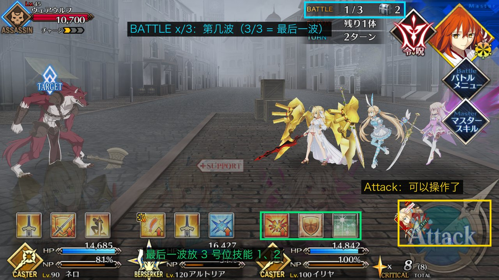

# FGO 自动刷本（fgo-auto）

通过 ADB 控制 BlueStacks 模拟器（1920×1080），**按固定坐标点击，只认几个最基本的画面**（攻击按钮、BATTLE 字样、选卡界面、结算页等），自动连续刷本、吃苹果、处理好友申请。



- 6 种模式：刷素材 / 刷 QP / 3 波本固定打法 / 活动周回 / 90++周回 / 活动单刷 hardcode 版
- 每一步先确认画面再点，画面不对就等，不乱点
- 启动时输入要吃几个苹果，吃满或 AP 用完自动停

## 项目在这里 👉 [`Downloads/Gaming/fgo/`](https://github.com/lottjiayee/fgo-auto/tree/main/Downloads/Gaming/fgo)

完整说明（流程图、各画面截图、模式对照、参数、文件结构）见 **[Downloads/Gaming/fgo/README.md](https://github.com/lottjiayee/fgo-auto/blob/main/Downloads/Gaming/fgo/README.md)**。

## 快速开始

```bash
git clone https://github.com/lottjiayee/fgo-auto.git
cd fgo-auto/Downloads/Gaming/fgo
bash start.sh        # 自动建 venv、装依赖，进菜单选模式 1-6，再输入苹果数量
```

停止：**Ctrl + C**（会打印总结）。
