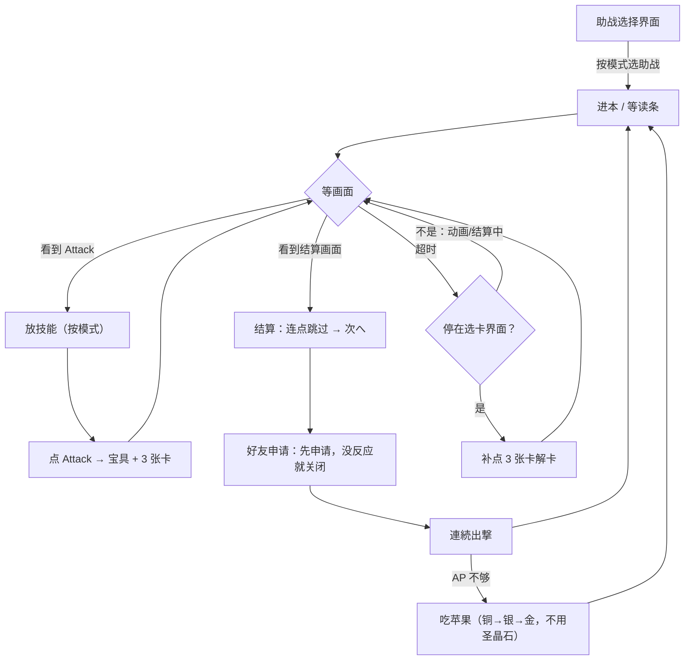
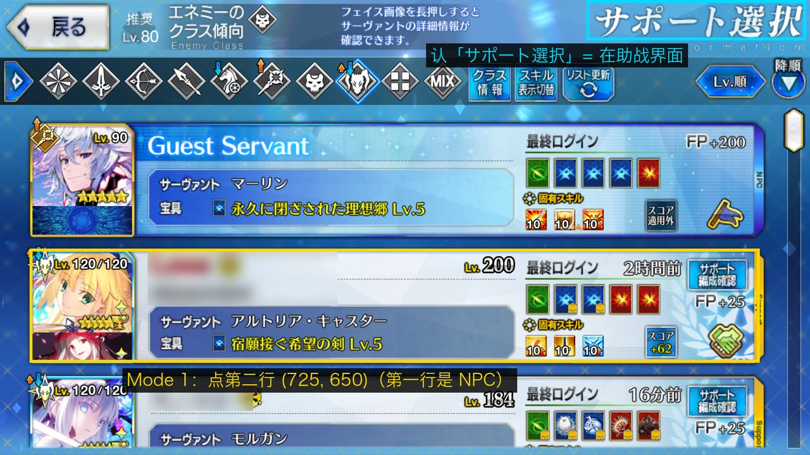
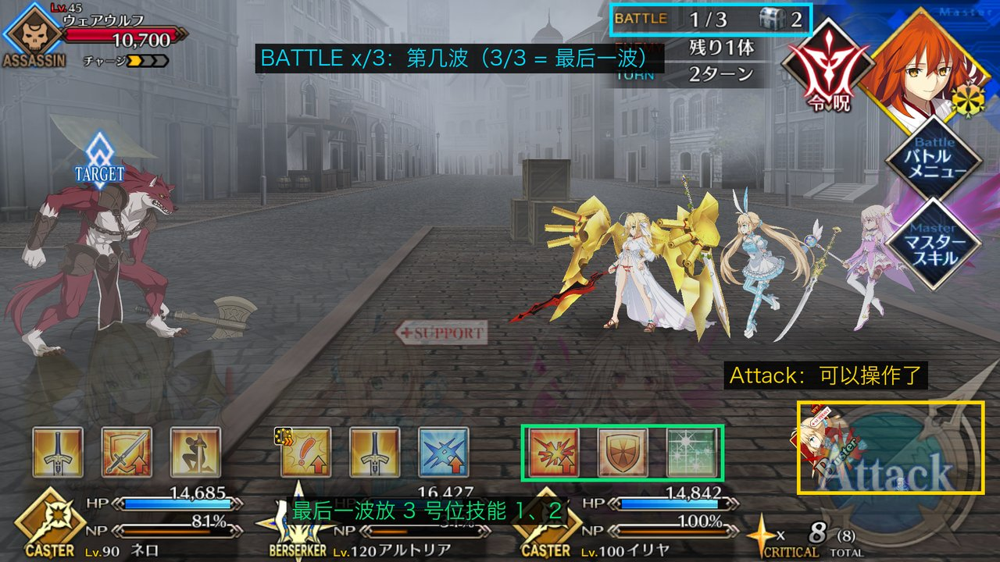
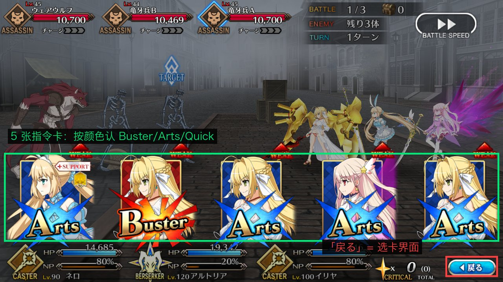
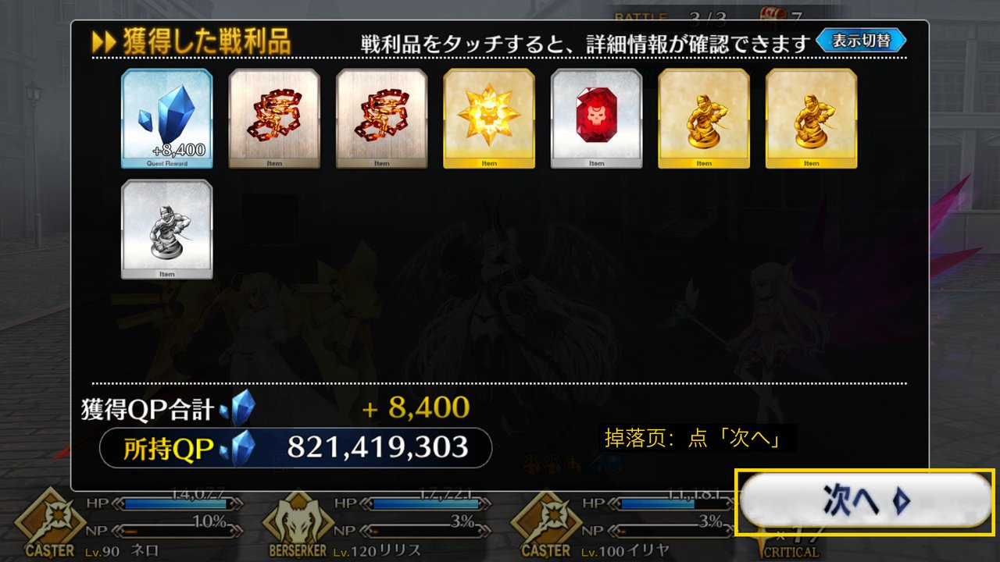
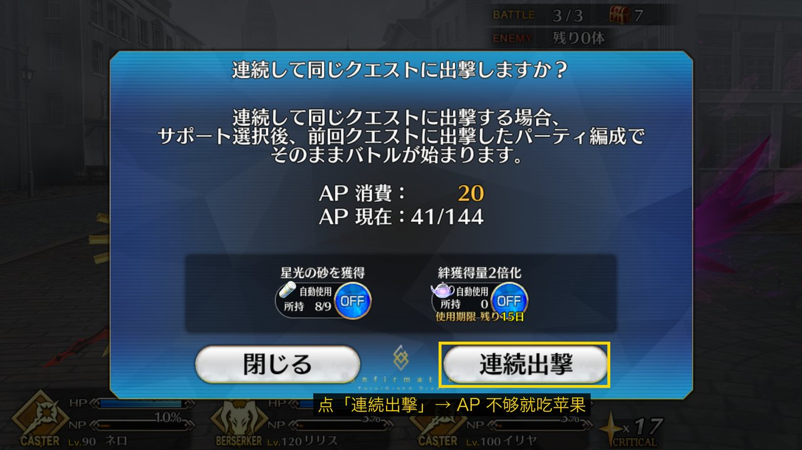
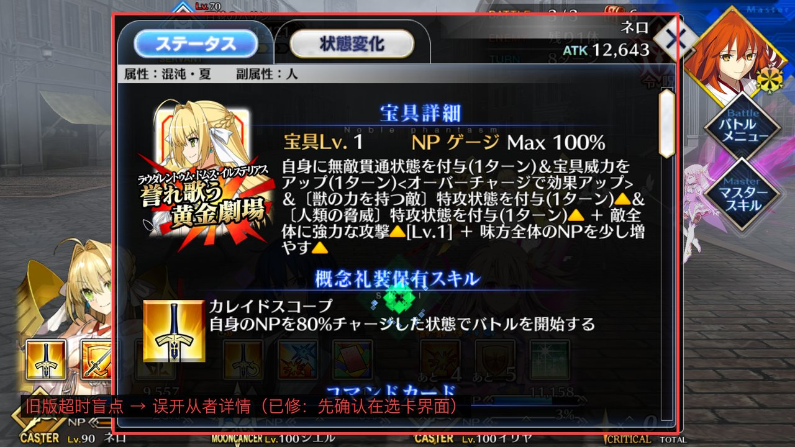

# FGO 自动刷本

通过 ADB 控制 BlueStacks 模拟器（1920×1080），**按固定坐标点击，只认几个最基本的画面**（攻击按钮、BATTLE 字样、选卡界面、结算页等），自动连续刷本、吃苹果、处理好友申请。

- 6 种模式：刷素材 / 刷 QP / 3 波本固定打法 / 活动周回 / 90++周回 / 活动单刷 hardcode 版
- 每一步先确认画面再点，**画面不对就等，不乱点**
- 启动时输入要吃几个苹果，吃满或 AP 用完自动停

---

## 运行流程



## 脚本看到的画面

**1. 助战选择** — Mode 1 直接点第二行（第一行是 NPC）。Mode 2 / 5 / 6 先认右上角「サポート選択」确认在助战界面，再认图找指定助战，找不到就往下拉到底、刷新列表。



**2. 战斗中** — 看到 **Attack** 才操作；右上角 **BATTLE x/3** 判断是第几波（3/3 = 最后一波）。



**3. 选卡** — 按卡面颜色认 Buster / Arts / Quick。右下角「戻る」用来确认停在选卡界面。



**4. 结算** — 掉落页点「次へ」，然后「連続出撃」；AP 不够就按上限吃苹果。

| 掉落页 | 連続出撃 |
|---|---|
|  |  |

**为什么超时前要先确认画面？** 旧版超时后会直接在卡位上盲点，宝具动画太长时点到从者头像，弹出详情面板：



现在只有认出选卡界面（「戻る」）才补点，动画或结算中一律只等不点。

---

## 开始前
1. 模拟器分辨率 **1920×1080**，开启 ADB（默认 `127.0.0.1:5555`）。
2. 游戏里点进要刷的关卡，停在**助战选择界面（サポート選択）**，列表在最顶上。
3. 编好队（各模式默认的队伍位置见下面「模式」）。

## 启动

```bash
cd fgo-auto/Downloads/Gaming/fgo
bash start.sh                            # 第一次：自动建 venv、装依赖，再进菜单
venv/bin/python fgo.py                   # 菜单选模式 1-6，再输入苹果数量
venv/bin/python fgo.py --script-mode 1 --count 10 --apple 3   # 直接指定：Mode 1、刷 10 场、最多吃 3 个苹果
```

常用参数：

| 参数 | 说明 |
|---|---|
| `--script-mode N` | 模式 1–6，不填就进菜单 |
| `--count N` | 刷 N 场，0 = 不限（不会写进 config.json） |
| `--apple N` | 最多吃几个苹果，0 = 不吃；不填就启动时问 |
| `--device` | ADB 地址，默认 `127.0.0.1:5555` |
| `--card-strategy` | 选卡策略，默认 `round_robin` |
| `--debug` | 打印更多日志 |

## 停止
- 按 **Ctrl + C**（会打印总结：场数、苹果、耗时）。
- **不要按 Ctrl + Z**，那只是挂起，进程还在。挂起了就 `fg` 再 Ctrl + C，或 `pkill -f fgo.py`。
- 同一时间只跑一个脚本；运行中不要点模拟器。
- 改了代码要 **Ctrl + C 再重新启动** 才生效。

## 自动停止
- 跑满 `--count` 场数
- AP 不足且已吃满苹果上限
- 连续失败 3 次（比如不在助战界面）
- 设备断开

## 模式

| 模式 | 用途 | 打法 | 助战 |
|---|---|---|---|
| 1 | 刷素材 | 前几波只出卡；最后一波（3/3）放 3 号位技能 1、2，**3 个宝具全点 + 3 张卡** | 点第二行 |
| 2 | 刷 QP | 第 1 回合放技能，每波宝具，随机出卡；进本先等读条 | 认图找 Castoria（找不到照常继续） |
| 3 | extra1（3 波本） | wave2 从者 1、2 宝具；wave3 换人 + 技能 + 从者 2、3 宝具 | 第一行 |
| 4 | 特别活动周回 | 每波 3 宝具 + 补满 3 张卡 | 第一行 |
| 5 | 90++周回（活动 3 波本） | 队伍 オルガマリー（助战）/ 孔明 / 光のコヤンスカヤ，アトラス院制服。第 1 波全员技能（要选目标的给 1 号位）+ 御主技能 3，出 B→Q→A；第 2 波 1 号位宝具 + 2 张 Buster；第 3 波 オルガマリー 技能 2→3→1，Buster 优先。波数看右上角 BATTLE x/3 | 找带指定礼装、而且礼装满破（右边有闪光）的 Uーオルガマリー，一直刷新到找到 |
| 6 | 活动单刷 hardcode 版 | 最早一版 Mode 5 打法（单波本，9 个技能给 1 号位，不换人），技能 / 选目标 / 出卡全按坐标和固定等待 | 同 Mode 5 |

旧版 Mode 5（单波本）的出卡画面（1 号位 Uーオルガマリー）：


各模式的实录和细节：
- [`records/mode5_turn1.md`](records/mode5_turn1.md)：Mode 5 各版本的实录（点击顺序和坐标）
- [`records/support_search.md`](records/support_search.md)：助战搜索（下拉到底、刷新、认名字 / 礼装 / 头像）

## 配置（config.json）

```json
{
  "run_count": 0,
  "apple_limit": 0
}
```

- `run_count`：默认刷几场，0 = 不限
- `apple_limit`：启动时直接回车用的苹果上限，0 = 不吃

## 文件

```
fgo.py                  入口：菜单、参数、苹果数量
start.sh                建 venv、装依赖、启动
config.json             默认场数 / 苹果上限
FGO/
  fgoModeBase.py        共享流程：选助战 / 战斗 / 结算 / 吃苹果 / 连场
  fgoMode1.py ~ 6.py    各模式的差异（技能、宝具、出卡、助战）
  fgoCardSelector.py    认卡色、选卡策略
  fgoDetect.py          模板匹配
  fgoAndroid.py         ADB 点击 / 滑动 / 截图
  fgoDevice.py          设备初始化
templates/              识别用的截图模板（攻击按钮、结算页、戻る 等）
records/                实录和做法说明
docs/images/            README 用的截图
```

运行日志 `fgo_*.log` 只留最近 30 个，不上传。
